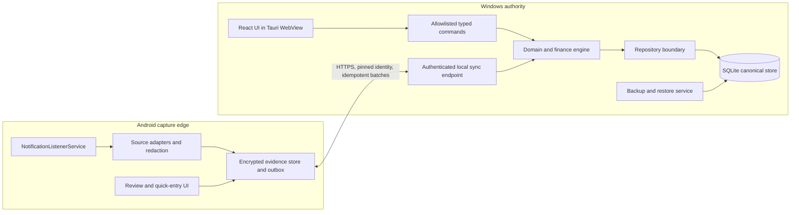
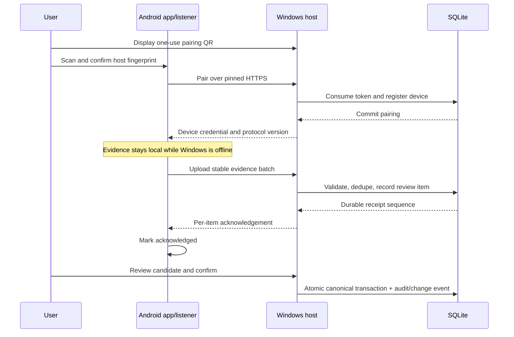
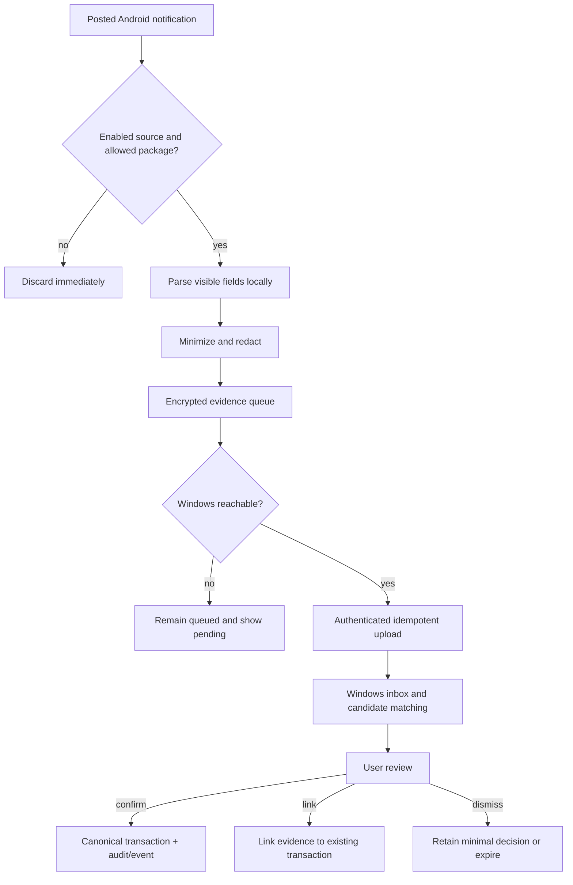

# Aether Phase 2 — Complete System Architecture

**Status:** Architecture decision for implementation planning  
**Date:** 2026-10-31  
**Scope:** Combines platform/runtime (former 2.3), security and synchronization (2.4), and capture/reconciliation (2.5). Design only: no application code, dependencies, schema, migration, or platform feature is implemented by this document.

## 1. Executive decision

Aether remains local-first with no cloud service in the initial release. Windows is the sole authority for canonical financial records. Android is a capture and interaction companion with a durable local outbox; it may hold notification evidence and pending drafts, but cannot silently become a second authority for accounts, transactions, trades, loans, or valuations.

- **Windows:** package the existing React/Vite UI as a **Tauri 2 desktop app**. A narrow Rust host owns SQLite, migrations, the local authenticated sync endpoint, and backup/restore. Keep the Vite/browser path for development; it is not the production data authority.
- **Android:** use **Capacitor 8** for the React UI, plus a small native Android module for `NotificationListenerService`, encrypted evidence/outbox storage, and permission flows. A plain browser wrapper cannot provide the OS notification listener.
- **Persistence:** retain the `FinanceRepository` boundary and finance engine. Once the Windows native owner exists, SQLite is the canonical store. Android holds only encrypted pending evidence/drafts, not a second full ledger. Phase 2.2 is a proposal, not an implemented schema; align it before migration.
- **Communication:** Android initiates HTTPS sync to Windows over the same trusted local network. Pair by scanning a short-lived QR displayed by Windows. QR carries endpoint, host certificate fingerprint, one-time secret, and protocol version. Pin the certificate and issue per-device credentials. No cloud rendezvous, port forwarding, Bluetooth dependency, or LAN broadcast as a security control.
- **Capture:** process only notifications the user enabled and the source app actually posts with useful fields. GPay and bank SMS are captured through posted notifications only. Assume no public GPay history API and no unrestricted SMS inbox access. A capture is evidence, not a canonical transaction.
- **Reconciliation:** deterministic dedupe first, conservative suggestions second, user review before canonical creation/linking. Keep provenance and decision state; multiple evidence items may support one canonical transaction.

This decision selects a desktop host because browser-only Windows cannot provide the dependable, app-owned database endpoint Android needs while the UI is closed. It makes database ownership, local connectivity, offline capture, and platform-specific notification access explicit while preserving React and pure finance logic where sensible.

## 2. Repository baseline

Inspection found a React/TypeScript/Vite app with no Tauri or Capacitor runtime. `src/db/database.ts` defines Dexie/IndexedDB stores; `src/repositories/dexie.ts` implements persistence and `src/repositories/types.ts` is the repository contract. `src/domain/types.ts` defines integer-paise money as JavaScript `number`, signed canonical transactions, accounts, investments/trades, valuations, loans, audit, imports and backups. `src/engine/` contains finance calculations, imports and duplicate suggestions. `src/db/backup.ts` validates versioned JSON backup records and transfer pairs, but the current export omits operational tables such as audit/import history and has no sync/device concepts. The repository contains tests for repositories, backup, domain money and calculations; no tests were run for this design task.

`docs/architecture/Phase-2.2-SQLite-Storage-Design.md` is a future SQLite-shaped proposal. It is not current runtime behavior. Its integer-paise and relational constraints are a starting point; it must be aligned with single-writer authority, evidence, idempotency, audit, deletion and restore semantics before implementation.

**Write boundary:** Android can submit evidence and user-authored drafts offline. Windows validates and confirms canonical writes. Every Windows-originated mutation (manual entry, import, edit, delete, restore) must use one transaction boundary and be recorded for audit/sync.

## 3. Structure and boundaries

The WebView is not trusted with filesystem or raw SQL access. The Rust host exposes narrow typed commands and validates input. No general SQL or broad filesystem permission is exposed. Android's listener is a sensitive collection surface: filter packages, minimize text, never forward all notifications, and show enabled sources plus pause/revoke controls.

Shared code boundaries:

1. **Pure TypeScript domain:** money/date validation, normalized DTOs, duplicate scoring and deterministic calculations. No browser, Dexie, Android or SQL dependencies.
2. **Windows authority:** Rust/Tauri host, SQLite repository/migrations, audit/change log, sync protocol and backup/restore. React uses an adapter implementing the existing repository contract.
3. **Android edge:** Capacitor React shell and Kotlin listener/local store. Native code owns callbacks, permission and secure storage; JS owns presentation/review. Bridge DTOs are versioned JSON.

Share accounting rules and DTOs, not one UI lifecycle or persistence adapter across both platforms.

## 4. Technology decision records

### TDR-01 — Windows browser or desktop

**Decision:** Tauri 2 desktop for production authority; keep Vite/browser development.

**Rationale:** Windows must own a database and accept sync independent of a focused browser tab. Browser PWAs are installable and app-like on Windows but do not provide the required reliable background HTTPS host. Tauri embeds the web UI and supports explicit capabilities for restricting native commands. Its SQL plugin supports SQLite, but direct SQL from UI is rejected: commands call a typed repository instead.

**Tradeoffs:** Rust host, packaging/signing/update work, WebView2 deployment validation and native supply-chain surface. Electron is viable but has a larger runtime and Node surface without a current need. No compatibility spike has yet been performed.

### TDR-02 — Android native or wrapper

**Decision:** Capacitor 8 with custom Kotlin listener and encrypted queue; a native Android app containing the web UI, not a browser-only PWA.

**Rationale:** Capacitor can be added to a modern web app and bridged to custom native code. `NotificationListenerService` is an OS-declared service requiring user-approved notification access; it is not a browser feature.

**Tradeoffs:** separate platform release path, lifecycle/security expertise and bridge maintenance. Fully native Kotlin UI duplicates work; browser-only cannot collect notifications in background. Capacitor is a decision, not an installed dependency in this design phase.

### TDR-03 — Database authority and SQLite timing

**Decision:** Windows host alone owns canonical SQLite. Android stores encrypted pending evidence/drafts. Adopt SQLite only after the native owner and repository adapter boundaries are established; do not add it to the browser runtime.

**Rationale:** SQLite transactions support atomic acceptance of a canonical write with its audit/change record. The repository interface and finance engine are migration seams. Phase 2.2 DDL must be revised for this authority and for evidence, receipts, devices and event sequence. Enable and verify foreign keys on every connection. Use a consistent backup operation, not a live file copy. SQLCipher is not selected until packaging, key recovery and backup are prototyped. Baseline at-rest protections are Windows account ACLs/BitLocker and Android app-private storage with Keystore-wrapped keys.

**Alternatives:** Dexie as authority leaves no dependable Android host service; SQLite on Android creates dual ledger authority; cloud violates the no-cloud constraint. SQLite's signed 64-bit integers exceed exact JS `number` range, so continue rejecting values/intermediate totals outside `Number.MAX_SAFE_INTEGER` paise until a money-type change is designed.

### TDR-04 — Local transport

**Decision:** Windows host listens only on private LAN interfaces while Aether is running; Android initiates HTTPS. MVP sync is user-triggered, with bounded retries when both devices are online.

**Rationale:** Android needs no inbound reachability and there is no cloud relay. QR bootstraps endpoint and identity. Expose only pairing, status, evidence upload, draft submission, acknowledgement and revocation routes. mDNS may be a post-pairing convenience, never a trust control.

**Conditions/tradeoffs:** Windows firewall, guest Wi-Fi/client isolation, VPNs, IP changes, sleep and app closure can prevent sync. No public listener or port forwarding. If sync while Windows is closed is required, service/tray lifetime and user-session model must be redesigned before implementation.

### TDR-05 — Canonical writes

**Decision:** Android submits idempotent evidence/draft commands. Windows validates references, amount/account and user confirmation, then atomically commits canonical records plus audit/change sequence. Never accept Android snapshots or use last-write-wins for the ledger.

**Rationale:** financial changes need explainable history. Stable IDs make retries safe; explicit conflicts preserve user intent and current authority.

## 5. Pairing and sync protocol

### Pairing

1. User opens **Pair Android** in Windows. Host creates a random one-use secret (at least 128 bits), five-minute expiry, nonce, protocol version, endpoint candidates and TLS certificate fingerprint. QR is displayed locally and never logged.
2. Android scans while on the same trusted network and displays the Windows device name/fingerprint. User confirms; Android sends the secret over TLS.
3. Android generates a device signing keypair in Android Keystore; the private key is non-exportable. Windows consumes the token, registers the device ID and public key, then issues a random device credential. Android stores that credential encrypted with a Keystore-protected key; Windows stores a verifier. Scope is limited to `upload_evidence`, `submit_draft`, and `read_ack_status`; no full-ledger download by default.
4. Requests include device ID, protocol version, stable request ID, monotonic device sequence, timestamp, payload hash and a device-key signature over method/path/body hash/nonce. TLS protects transport; signature and nonce reject replay. Same request ID and payload returns prior result; same ID with a different payload hash is rejected.
5. Both devices show paired device and last sync. Windows revocation invalidates credentials immediately. Re-pairing issues a new credential. Host certificate rotation requires explicit recovery/re-pair.

Do not silently trust arbitrary self-signed certificates. Prototype Android network security configuration, private-address routing, Windows firewall/binding and certificate lifecycle for supported versions. QR identity does not make an unreachable LAN reachable.

### Delivery, ordering, conflicts

Android stores immutable evidence envelopes with `evidenceId`, `deviceId`, source package, notification key/fingerprint, observed time, normalized fields, parser version and redaction state. Opaque encrypted raw text is optional and off by default.

Upload bounded batches (initial target: at most 100 items / 256 KiB compressed) with stable IDs. Host returns per-item `accepted`, `already_seen`, `needs_review`, `rejected_invalid`, or `rejected_revoked` plus durable host receipt sequence. Android deletes only after durable acknowledgement; otherwise it retries with exponential backoff and jitter capped at six hours and displays pending count. Host dedupes `(deviceId,evidenceId)` and then keyed source fingerprint. Changed payload under same key is quarantined, never silently overwritten.

Each host-committed change gets an `eventId` and monotonically increasing per-install sequence, committed atomically with canonical data. Android may query acknowledgements since last sequence. Gaps replay from host log; if restore removed history, a snapshot/rebase handshake is required. Host remains single writer, so normal ledger conflicts are avoided. If a draft references a record edited/deleted meanwhile, return conflict with current version and preserve draft. No automatic merge of amount, date, account, kind or transfer legs; descriptive text may be merged only after review. Device clocks are informational; host sequence determines order.

## 6. Offline, backup, restore and revocation

- **Android offline/Windows off:** retain evidence in encrypted outbox; quick-entry is a marked draft. Show “waiting for Windows,” pending count, and last sync. Listener delivery is not guaranteed if permission is disabled, app is force-stopped, OS disconnects it, source suppresses notification, or device policy/battery restrictions intervene.
- **Windows offline to Android:** canonical workflows continue and acknowledgements/events queue locally. No cloud fallback. Devices converge at next authenticated sync.
- **Unavailable host:** retry with backoff; never mark delivered before receipt. Android may export an encrypted recovery bundle of pending evidence, imported/reviewed explicitly on Windows.
- **Windows backup:** versioned encrypted backups created by SQLite online backup API or equivalent host-consistent snapshot, with schema metadata/checksum. Verify by restoring into a temporary DB, then atomically replace active DB while closed. Never copy only the main file during WAL writes. Keep at least one user-selected external copy; local-only backups do not survive disk failure.
- **Restore:** explicit confirmation and pre-restore backup. Validate schema, integrity, foreign keys, IDs, money bounds and event sequence. Increment authority epoch. Devices detect epoch change, upload pending evidence idempotently, reset cursors and re-sync; drafts remain reviewable.
- **Revocation:** Windows revokes a device; Android can unpair/erase local data. Revoked queued data cannot sync. Evidence in prior backups cannot be remotely erased; disclose retention.

## 7. Capture, evidence and reconciliation

### Platform limits and capture boundary

Android's `NotificationListenerService` receives posted/removed callbacks for notifications within its access/filter and can read only fields the source app exposes. It is not access to the source app's private transaction history or to unposted past notifications. The user grants notification access in system settings. Android documentation notes restrictions for low-RAM Android Q and earlier and work profiles. Notification format and visibility vary by issuer, locale, privacy setting, channel, app version and grouping; amount/date/account/reference may be absent.

- **Google Pay:** parse only payment notifications emitted by the installed GPay app when enabled. No public transaction-history API is assumed. Notifications can be suppressed, redacted, grouped or revised; absence is not proof no payment happened.
- **Bank SMS:** parse only bank/SMS-app notifications actually posted and exposed to the listener. Do not request `READ_SMS` or scan inbox history. Google Play generally restricts SMS permissions to eligible default handlers or policy exceptions. Suppressed/hidden/grouped/preview-only messages cannot be recovered.

Allow only configured package IDs; parse on device; discard irrelevant notifications immediately. Normalize amount, date, currency, account suffix, merchant, reference, source package and parser confidence. Use keyed hashes rather than plain hashes of predictable sensitive text. Do not collect unrelated app content, contacts, full phone numbers, notification actions or credentials.

### Evidence/review model

Conceptual states: `captured_local -> uploaded_unreviewed -> candidate_linked | draft_ready -> confirmed | dismissed | needs_attention`.

Evidence is immutable as observed. Parser updates create a new normalized interpretation with parser version and preserved provenance. User edits live in a review draft. Evidence never silently edits/deletes canonical records. Multiple evidence items link to one transaction; manual/imported canonical transactions can have no evidence.

Matching order:

1. Exact trustworthy source reference, if exposed.
2. Account (if known), exact signed amount/currency, compatible direction and tight date window.
3. Normalized merchant/description and account suffix as supporting signals only.
4. Consider reversals/refunds separately; opposite-sign events are not duplicates.

Use deterministic explainable score; display matched fields, time delta, source and confidence. No auto-confirm in initial release. Existing `findPotentialDuplicates` scores date/amount/account/kind/description/reference; it is a starting point for pure logic, not final identity because notification fields are partial/noisy. Characterize it with fixtures before reuse.

Review inbox shows source, observed time, parsed date/amount/merchant preview, confidence, candidate canonical record and match explanation. Actions: confirm new transaction; link to existing; edit draft then confirm; mark duplicate evidence; dismiss with reason; retry parser. User verifies account/category when missing. Transfer, loan and investment classification requires explicit user choice.

## 8. Privacy and threat model

Raw notification text is off by default. Retain normalized evidence until resolved and for a configurable short audit window (90 days proposed, not validated); then purge sensitive content and keep only a minimal link/decision if needed. Pending evidence stays until acknowledgement or user deletion. Offer clear-all and per-source pause/delete controls on both devices. Confirm retention and jurisdictional requirements before release.

| Threat | Controls | Residual risk |
|---|---|---|
| LAN observer/rogue AP | HTTPS, pinned host cert, one-use QR secret, per-device signatures, narrow routes, rate limits | Paired compromised Android can submit malicious evidence/drafts |
| Rogue device or false evidence | Pairing approval, source allowlist, size limits, evidence-only upload, Windows review, revoke | User can approve a false suggestion |
| WebView compromise | Tauri capabilities minimized, typed commands, host validation, no raw SQL, CSP and signed releases | Rust/host vulnerabilities remain high impact |
| Windows compromise | Account ACLs, BitLocker, app lock/session timeout, audit and verified backups | Malware/unlocked session can expose or alter ledger |
| Android loss | App-private encrypted queue, Keystore key, lock-screen privacy, revocation | Unlocked/rooted device may expose pending evidence |
| Retry/replay | Stable IDs, payload hashes, durable idempotency receipts and host sequence | Bad key reuse must be surfaced/quarantined |
| Disk loss/corruption | Verified backup/restore, external-copy reminder, integrity checks | Without cloud, off-device backup is user's responsibility |
| Parser drift/error | Parser version, confidence, provenance, no auto-canonicalization, review | User may approve incorrect draft |
| QR exposure | One-use random token, five-minute expiry, user confirmation, immediate consumption | Nearby person can race an active pairing |

Encryption is required in transit. Android queue uses a random data key protected by Android Keystore. Windows baseline is OS ACLs and full-disk BitLocker. Prototype SQLCipher for copied-file protection only if packaging, performance and key recovery work; encryption does not protect data while host is unlocked. Backups need a recoverable encryption key/secret and an explicit loss/recovery story.

## 9. Phase 2.2 alignment gate

Keep the proposal's core entities (accounts, categories, transactions, investments, trades, valuations, loans) and integer-paise convention as a starting point. Before implementing SQLite:

- Resolve model mismatches: `transferPairId` vs proposed transfer groups; `knownOutstanding` shape; optional references not uniformly validated; current deleted transaction, audit, import and backup stores.
- Add separate concepts for evidence, evidence-to-transaction links, review decisions, paired devices, idempotency receipts, authority epoch and host change sequence. Never put raw notification text in canonical descriptions by default.
- Define transaction + audit + outbound event as one commit. Define deletion/tombstone/undo so retries cannot silently resurrect rows.
- Preserve one canonical row per real cash effect. Transfers have balanced paired legs; trade/loan components link to settlement; additional evidence links rather than duplicating a transaction.
- Enforce money bounds. SQLite INTEGER is signed 64-bit but JS `number` is exact only to `Number.MAX_SAFE_INTEGER`; reject larger amounts and aggregate intermediates until money type changes.
- Define WAL/checkpoint and host-consistent backup behavior; do not copy a live main DB alone.

No final DDL is included: revise Phase 2.2 after these decisions and source mismatches are reviewed together. This is the gate before SQLite implementation.

## 10. Roadmap and acceptance criteria

### Stage A — Authority/runtime spike

- Tauri opens the React UI, invokes a typed repository operation, persists across restart and stores DB in the per-user data directory.
- Host binds only on private LAN; health/pair/sync routes work; Windows firewall, sleep, IP change and VPN behavior documented.
- Review confirms WebView has no broad SQL, filesystem or shell access.
- Decide SQLCipher vs OS-protected SQLite from a prototype including backup recovery.

### Stage B — Repository and migration

- Finance UI/engine use repository contract with parity for reads/writes, imports, audit, backup/restore.
- Dexie/JSON migration is repeatable, validates foreign keys/invariants, preserves IDs and signed paise, reports invalid rows, and retains source until user verifies migrated backup.
- Exercise interruption, duplicate IDs, unbalanced transfers, unsafe money values, restore and rollback.

### Stage C — Pairing and sync

- Pair token expires/is single-use; fingerprint mismatch blocks; device list and immediate revocation work.
- Retries/duplicate uploads produce one receipt; same ID/different payload is rejected; out-of-order/missing acknowledgements recover by host sequence.
- Offline queue survives restart and clears only after durable acknowledgement; Windows is sole canonical writer.
- Exercise LAN isolation, revoked device, malformed payload, clock skew, upgrade and restored-host epoch.

### Stage D — Capture/review MVP

- User explicitly grants notification access and selects packages; listener state/disconnection visible; only allowed packages captured.
- GPay/bank fixtures cover redacted, grouped, duplicate, malformed, localized and revised notices. Parser never emits canonical transactions.
- Review supports confirm, link, edit-and-confirm, duplicate/dismiss with provenance.
- Denied permission, missing source app, suppressed notification and listener disconnect are visible; product makes no completeness claim.

### Stage E — Hardening/release

- Restore verified on clean Windows profile; external backup and lost-device/key recovery documented.
- Signed packages, update/rollback, OS support, retention, privacy disclosure and security response defined.
- Security review covers native bridge, TLS pinning, LAN exposure, Android keys/storage, data minimization and dependencies.

## 11. Remaining material uncertainties

1. **Windows lifetime:** MVP sync requires Aether open. Always-available sync requires a service/tray startup, user-session boundary and firewall decision before Stage A closes.
2. **Real LAN behavior:** local HTTPS, pinning, Android routing, firewall and client-isolated Wi-Fi must be prototyped; pairing cannot overcome network isolation.
3. **Distribution:** Store vs sideload affects signing, policy, updates and disclosures. Avoiding inbox SMS permission removes a major Play policy dependency.
4. **Notification formats:** issuers can change or suppress data; no completeness guarantee. Parsers need ongoing fixture maintenance.
5. **At-rest encryption and key recovery:** choose SQLCipher only after prototype and recoverability design.
6. **Retention/legal:** proposed 90 days is an assumption, not legal advice; validate jurisdiction and privacy policy.

These are implementation gates, not reasons to defer the architecture milestone. Windows authority, runtimes, flow, trust boundaries, transport and reconciliation are decided. Assumptions: one Windows authority and one primary Android device initially; multi-user/multi-Android collaboration is out of scope.

## 12. Verified source notes

Current primary docs support these platform claims; recheck version-specific behavior at implementation:

- Android listener callbacks, declaration and limitations: [NotificationListenerService](https://developer.android.com/reference/android/service/notification/NotificationListenerService); [listener access approval](https://developer.android.com/reference/android/app/NotificationManager#isNotificationListenerAccessGranted(android.content.ComponentName)).
- Standard Android notification title/text extras are only what the originating app supplies, not a transaction-history API: [Notification API](https://developer.android.com/reference/android/app/Notification).
- SMS/call-log permissions on Google Play generally require default-handler status or an exception: [Android default-handler guidance](https://developer.android.com/guide/topics/permissions/default-handlers).
- Capacitor can be added to an existing modern web app and supports custom native plugins: [Getting started](https://capacitorjs.com/docs/getting-started), [overview](https://capacitorjs.com/docs).
- Tauri capabilities scope native commands to WebViews; SQL plugin supports SQLite though selected architecture keeps SQL behind typed host repository: [capabilities](https://tauri.app/security/capabilities/), [SQL plugin](https://v2.tauri.app/plugin/sql/).
- Edge PWAs have app-like Windows integration; this does not document an app-owned LAN host service: [Microsoft Edge PWA behavior](https://learn.microsoft.com/microsoft-edge/progressive-web-apps-chromium/ux).
- Bluetooth/Wi-Fi peer permissions vary by Android API level; neither is a sync dependency: [Bluetooth](https://developer.android.com/develop/connectivity/bluetooth/bt-permissions), [Wi-Fi](https://developer.android.com/develop/connectivity/wifi/wifi-permissions).
- SQLite transactional atomicity, WAL checkpoint behavior and live backup API: [atomic commit](https://www.sqlite.org/atomiccommit.html), [WAL](https://www.sqlite.org/wal.html), [online backup](https://www.sqlite.org/backup.html).

**Verified facts vs recommendations:** cited docs substantiate platform API behaviors. Tauri + Capacitor is an architectural recommendation based on repository shape, not an experimentally proven compatibility result. LAN protocol, key handling, parser quality and Windows lifetime need Stage A/C/D prototypes.

